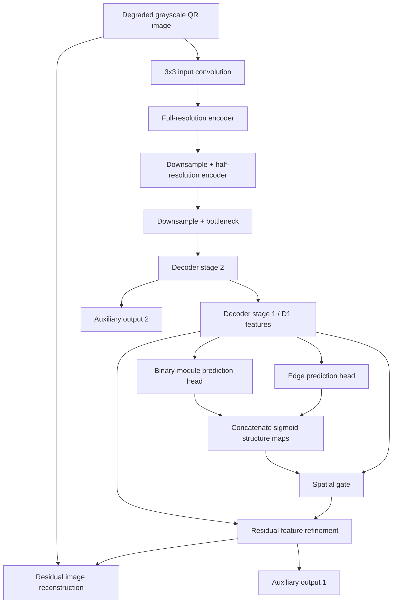

# QR-SGNet

**A Structure-Guided Multi-Scale Network for Unreadable QR Code Restoration**

QR-SGNet is a structure-guided image restoration network designed to recover QR codes that standard decoders cannot read. Instead of optimizing pixel reconstruction alone, the network explicitly learns QR-code structures—module boundaries and binary module layouts—and feeds these structural predictions back into the decoder through a spatially adaptive feature gate.

This repository contains the PyTorch implementation of the model and its supervised training pipeline.

## Highlights

- **Structure-conditioned feature modulation.** Edge and binary-module predictions are converted into spatial guidance and fed back to the decoder features through a bounded gate.
- **Self-derived structural supervision.** Edge targets are computed from reference images with normalized Sobel gradients; binary-module targets are obtained by thresholding the reference images. No manual structural annotations are required.
- **Multi-scale restoration.** A three-scale encoder–decoder with channel-attention blocks reconstructs the input at its original spatial resolution.
- **Joint optimization.** The model is trained with reconstruction, auxiliary reconstruction, edge, and binary-structure losses.
- **Decoder-oriented evaluation.** The manuscript evaluates restored images using both OpenCV's `QRCodeDetector` and the WeChat QR-code detector, in addition to PSNR, SSIM, and inference-time measurements.

## Method overview

Given a degraded grayscale QR-code image \(X\), QR-SGNet predicts a restored image \(\hat{I}\) with the same spatial dimensions as the input. Its decoder produces a feature map \(D_1\), from which two auxiliary heads predict an edge map and a binary-module map:

\[
S = \operatorname{Concat}(\sigma(E),\sigma(B)),
\]

where \(E\) and \(B\) are the edge and binary-structure logits. A 1×1 convolution combines the decoder features and structural predictions to generate a spatial gate:

\[
G = \sigma(W_dD_1 + W_sS + b).
\]

The gated feature is refined residually:

\[
D'_1 = D_1 + R\big(D_1 \odot (1+G)\big),
\qquad
\hat{I}=\operatorname{clip}(X+\operatorname{Conv}(D'_1),0,1).
\]

Since the sigmoid gate is in \((0,1)\), the multiplicative factor \(1+G\) is bounded between 1 and 2. The identity path is retained, while structural predictions provide spatially selective feature enhancement.

### Architecture



The implementation uses channel-attention blocks (CABs), Group Normalization, GELU activations, bilinear upsampling, and skip connections. With the default base width of 48, the model has **5,055,836 parameters** (approximately **19.3 MiB** in FP32), calculated directly from the included implementation.

## Dataset

The experiments in the accompanying manuscript use the public QR-code dataset released with the benchmark study by Sancar. The dataset contains three groups:

| Dataset split | Number of images | Description | Use in the manuscript |
|---|---:|---|---|
| Paired learning set | 15,999 pairs | Degraded inputs paired with high-quality reference images | Supervised training and reconstruction assessment |
| Unreadable real scans | 4,593 | Printed and scanned QR codes that OpenCV could not decode before restoration | Decoder evaluation |
| Unreadable simulated images | 2,899 | Synthetically degraded QR codes that neither OpenCV nor WeChat could decode before restoration | Decoder evaluation |

**Dataset source:** [Figshare dataset (DOI: 10.6084/m9.figshare.28424213.v1)](https://doi.org/10.6084/m9.figshare.28424213.v1)

The training code expects paired low-quality and high-quality images in separate directories. It first matches images by relative path and then falls back to a unique filename stem. Unmatched images are not used. Each matched pair must have the same dimensions.

Expected layout (the directory names can be changed through command-line arguments):

```text
QR-SGNet/
├── data/
│   └── raw/
│       └── Learning Data/
│           ├── low/       # degraded QR-code images
│           └── high/      # corresponding reference images
├── v4/
│   ├── __init__.py
│   ├── data.py
│   ├── losses.py
│   ├── metrics.py
│   ├── model.py
│   └── train.py
└── README.md
```

The real-scan and simulated evaluation sets are used for decoder evaluation in the manuscript. The training script included here consumes the paired learning set only.

## Installation

The included code uses Python, PyTorch, NumPy, Pillow, and scikit-image. Exact dependency versions were not recorded in the supplied code archive; install a PyTorch build appropriate for your operating system and CUDA environment.

```bash
# Create and activate a virtual environment first, if desired.
python -m pip install numpy pillow scikit-image

# Install PyTorch using the command recommended by the official selector:
# https://pytorch.org/get-started/locally/
```

### Important: package directory name

The supplied archive places the Python files in a directory named `code/`, while `train.py` imports modules from `v4` (for example, `from v4.model import QRMSRNetV4`). To run the code without changing those imports, rename `code/` to `v4/` after extracting the archive.

Linux/macOS:

```bash
mv code v4
```

Windows PowerShell:

```powershell
Rename-Item .\code v4
```

The repository layout shown above reflects the directory name expected by the current training script.

## Training

From the repository root, run:

```bash
python -m v4.train \
  --low_dir "data/raw/Learning Data/low" \
  --high_dir "data/raw/Learning Data/high" \
  --epochs 150 \
  --batch_size 8 \
  --lr 2e-4 \
  --base 48 \
  --seed 42 \
  --val_ratio 0.2 \
  --workers 4 \
  --output outputs/qr_v4
```

On Windows PowerShell, the same command can be entered on one line, or use PowerShell's backtick for line continuation.

### Training options

| Argument | Default | Description |
|---|---:|---|
| `--low_dir` | `data/raw/Learning Data/low` | Directory of degraded input images |
| `--high_dir` | `data/raw/Learning Data/high` | Directory of reference images |
| `--epochs` | `150` | Maximum number of training epochs |
| `--batch_size` | `8` | Training and validation batch size |
| `--lr` | `2e-4` | AdamW learning rate |
| `--base` | `48` | Base feature width of the network |
| `--seed` | `42` | Random seed |
| `--val_ratio` | `0.2` | Fraction of pairs assigned to validation |
| `--workers` | `4` | DataLoader worker count |
| `--output` | `outputs/qr_v4` | Output directory for checkpoints and training history |
| `--edge_weight` | `0.10` | Weight of the edge loss |
| `--binary_weight` | `0.05` | Weight of the binary-structure loss |

For the 15,999-pair dataset and the default 20% validation ratio, the split is 12,799 training pairs and 3,200 validation pairs. The training dataset applies paired random horizontal flips, vertical flips, and rotations by multiples of 90 degrees.

On Windows, or when multiprocessing causes issues, try `--workers 0`.

### Optimization settings

The supplied training script uses:

- Optimizer: AdamW, weight decay \(1\times10^{-4}\).
- Initial learning rate: \(2\times10^{-4}\).
- Batch size: 8.
- Maximum epochs: 150.
- Gradient-norm clipping: 1.0.
- Scheduler: `ReduceLROnPlateau` on validation PSNR, with factor 0.5 and patience 6.
- Checkpoint selection: highest validation PSNR.
- Random seed: 42.

### Loss function

The total objective is:

\[
\mathcal{L}_{total}=\mathcal{L}_{rec}
+0.15\mathcal{L}_{aux1}
+0.05\mathcal{L}_{aux2}
+0.10\mathcal{L}_{edge}
+0.05\mathcal{L}_{bin}.
\]

The main and auxiliary image outputs use the Charbonnier loss. The edge head is supervised with an L1 loss against normalized Sobel edge targets, and the binary head uses binary cross-entropy with logits against thresholded reference images.

## Outputs

After training, the output directory contains:

```text
outputs/qr_v4/
├── checkpoints/
│   ├── best.pth    # checkpoint with the best validation PSNR
│   └── last.pth    # checkpoint from the final epoch
└── history.json   # per-epoch training/validation statistics
```

Each checkpoint stores the model state, training arguments, epoch, and best validation PSNR.

## Reported results

The following results are reported in the accompanying manuscript for QR-SGNet:

### Reconstruction quality

| Metric | QR-SGNet |
|---|---:|
| PSNR | **41.57 ± 2.06 dB** |
| SSIM | **0.9987 ± 0.0007** |

These reconstruction metrics were calculated over all 15,999 paired images, including the training portion. They should therefore be interpreted as reconstruction results on the full paired learning set, not as metrics from a strictly held-out test set.

### Decoder success after restoration

| Evaluation set | Images | OpenCV success | WeChat success |
|---|---:|---:|---:|
| Paired set | 15,999 | 15,658 (97.87%) | 15,999 (100.00%) |
| Real scans unreadable by OpenCV before restoration | 4,593 | 4,367 (95.08%) | 4,593 (100.00%) |
| Simulated images unreadable by both decoders before restoration | 2,899 | 2,807 (96.83%) | 2,897 (99.93%) |

On the simulated set, only two images (0.07%) remained unreadable by both decoders after restoration.

### Comparison with previously reported baselines

| Method | PSNR (dB) | SSIM | OpenCV: real scans (%) | OpenCV: simulated (%) | WeChat: simulated (%) |
|---|---:|---:|---:|---:|---:|
| SRCNN | 34.54 | 0.7437 | 88.00 | 39.94 | 88.30 |
| ESPCN | 34.74 | 0.7461 | 92.64 | 41.18 | 83.92 |
| VDSR | 35.19 | 0.7506 | 92.07 | 90.92 | 99.48 |
| EDSR | 35.23 | 0.7509 | 92.77 | 94.72 | 99.72 |
| **QR-SGNet** | **41.57** | **0.9987** | **95.08** | **96.83** | **99.93** |

**Comparison caveat:** SRCNN, ESPCN, VDSR, and EDSR numbers are taken from the results reported by Sancar, rather than from re-runs using the exact same implementation, hardware, and evaluation protocol. The manuscript therefore treats these as reference comparisons, not as a fully controlled benchmark.

### Inference-time measurements

The manuscript reports the following mean per-image times (batch size 1):

| Evaluation set | Network (ms) | OpenCV decoder (ms) | WeChat decoder (ms) |
|---|---:|---:|---:|
| Paired set | 27.96 | 8.08 | 6.18 |
| Real scans | 18.11 | 8.51 | 6.33 |
| Simulated set | 17.94 | 8.04 | 6.24 |

The manuscript does not yet specify the exact GPU/CPU model and software versions used for these timing measurements. Runtime values should be regarded as reported measurements rather than hardware-independent guarantees.

## Evaluation and implementation scope

The supplied source archive includes:

| File | Purpose |
|---|---|
| `model.py` | QR-SGNet network definition (`QRMSRNetV4`) |
| `data.py` | Paired-image matching, grayscale loading, and augmentation |
| `losses.py` | Sobel targets and the combined training objective |
| `metrics.py` | PSNR and SSIM calculation |
| `train.py` | Training loop, validation, scheduler, and checkpoint saving |

**Current code release scope:** the supplied archive contains the model and supervised training components. It does **not** include a standalone inference script, a complete OpenCV/WeChat decoder-evaluation script, pretrained weights, or a dependency lock file. Consequently, the decoder success rates and timing results above are manuscript-reported experimental results and cannot be reproduced end-to-end using only the files in this archive. The `metrics.py` module provides image-level PSNR and SSIM calculation, but a full evaluation pipeline still needs to be added.

## Limitations and reproducibility notes

- The paired-set PSNR and SSIM values in the manuscript were computed over all paired images, including training images. A held-out-only reconstruction evaluation should be reported in a future update.
- Baseline values were taken from the published benchmark report and were not re-run under a matched setup.
- A decoder success is counted when the decoder returns a non-empty string. The manuscript does not verify that the decoded string exactly matches the original encoded content.
- The reported timing environment (GPU, CPU, and software versions) remains to be completed in the manuscript.
- The manuscript's qualitative attribution and feature visualizations are descriptive; they do not replace component-wise ablation experiments.
- Evaluation on perspective-distorted camera captures, glare, complex backgrounds, and other QR-code versions/error-correction settings remains future work.

## Reference

Sancar, Y. **Reconstructing unreadable QR codes: a deep learning based super resolution strategy.** *PeerJ Computer Science*, 11, e2841 (2025). [https://doi.org/10.7717/peerj-cs.2841](https://doi.org/10.7717/peerj-cs.2841)

## Citation

If you use this implementation, please cite the QR-SGNet manuscript. The author and publication information were not present in the supplied manuscript file, so the BibTeX entry below is a template and should be completed before publication:

```bibtex
@article{qrsgnet,
  title   = {QR-SGNet: A Structure-Guided Multi-Scale Network for Unreadable QR Code Restoration},
  author  = {Please add the author list},
  journal = {Please add the journal or conference},
  year    = {Please add the publication year}
}
```

## License

No license file was included in the supplied code archive. Add a `LICENSE` file before redistributing this repository, and make sure the dataset terms are followed separately.
